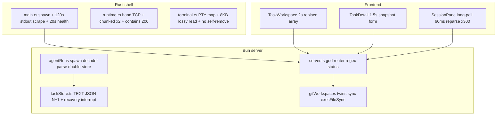

# C4 Level 3 — per-subsystem

Up: [containers](./c4-containers.md). Map: [codebase map](./codebase-map.md). Zooms: [rust](./zoom-rust.md) [server](./zoom-server.md) [frontend](./zoom-frontend.md) [providers](./zoom-providers.md).
