# Saber codebase map

Rendered with Mermaid (`flowchart TB`). Red nodes are the known-worst parts from the 2026-10-12 audit; each has evidence in the audit notes below the diagram.

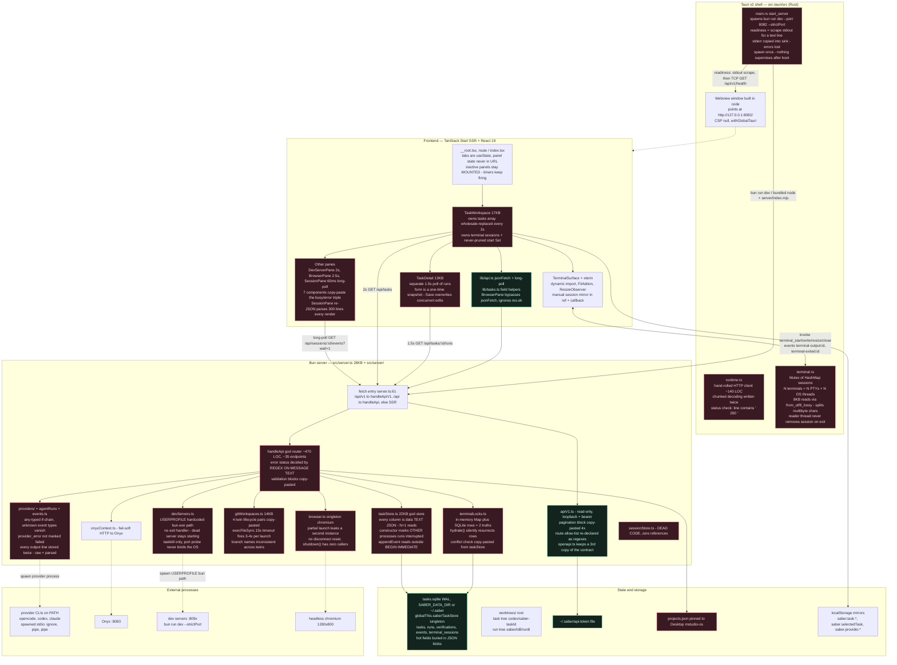

## Legend

- Red nodes: worst parts found in the 2026-10-12 audit, with the specific defect written into the node.
- Green nodes: layers that hold up (v1 API contract, token auth, SQLite WAL store itself, client fetch helper).
- Solid arrows: request/data flow. Dashed arrows: process spawns and side-channel boundaries.

## Audit notes: the five root diseases

Every red node traces to one of five patterns:

1. **Copy-paste instead of abstraction.** Validation x3, pagination x4, git lifecycle twins x4, busy/error triples x7, command lists x3, chunked decoders x2, exe resolvers x2. Every copy is a future divergence; the bench mock passes only because it is wrong in the same direction as the code.
2. **Two sources of truth.** Locks map vs SQLite rows, tasks array vs detail snapshot vs localStorage, raw+parsed event lines, port 8082 hardcoded in 4 places, route contract in 3 files, plus the dead sessionStore.
3. **String contracts.** HTTP status by regexing error messages, server readiness by scraping a vite banner line, provider events via an any-typed if-chain where unknown types silently vanish.
4. **Fire-and-forget lifecycle.** Spawn-once Rust server, chromium never disconnected, PTY sessions never removed on exit, dev servers with no exit handler, an append-only Set of terminal start requests.
5. **Windows-only paths in shared code.** USERPROFILE bun.exe, USERPROFILE opencode.jsonc, projects.json on Desktop, taskkill, powershell benchmarks. M7 is the Linux slice; these are its blockers, and they are in the TypeScript, not the Rust.
## Run lifecycle — POST task to finishRun

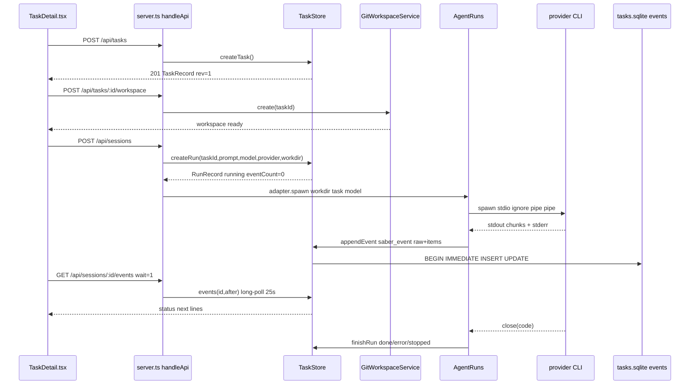

## Status state machine

```mermaid
stateDiagram-v2
  [*] --> idle: createTask
  idle --> running: createRun
  running --> done: close code 0
  running --> error: close code !=0
  running --> stopped: stop() taskkill/kill
  running --> interrupted: constructor recovery
  interrupted --> acknowledged: POST acknowledge confirm stopped
  acknowledged --> running: retry createRun
  done --> [*]
  error --> [*]
  stopped --> [*]
  acknowledged --> [*]
  idle -.-> interrupted: illegal, other process live run
```

## Startup gantt

```mermaid
gantt
  title Rust spawn to webview
  dateFormat X
  axisFormat %S
  section boot
  spawn bun dev --strictPort :0, 5
  stdout scrape listening line :5, 15
  health probe 500ms x 20s budget :15, 35
  build webview window :35, 40
  section budgets
  120s startup deadline :0, 120
  20s health deadline :15, 35
```

## Polling storm — 5 timers

```mermaid
gantt
  title Frontend pollers steady state
  dateFormat X
  axisFormat %S
  section TaskWorkspace 2s
  GET /api/tasks :0, 2
  GET /api/tasks :2, 4
  GET /api/tasks :4, 6
  section TaskDetail 1.5s
  GET runs :0, 1
  GET runs :1, 3
  GET runs :3, 5
  section DevServerPane 2s
  GET dev-servers :0, 2
  GET dev-servers :2, 4
  section BrowserPane 2.5s
  GET dev-servers :0, 2
  GET dev-servers :2, 5
  section SessionPane long-poll
  GET events wait=1 25s hold :0, 6
```

Steady idle ~127 req/min: 30 + 40 + 30 + 24 + ~3 long-poll. Live screenshots add 60/min. Active run bursts far higher because SessionPane re-polls 60ms after every non-terminal response.

## SQLite ER — TEXT blobs

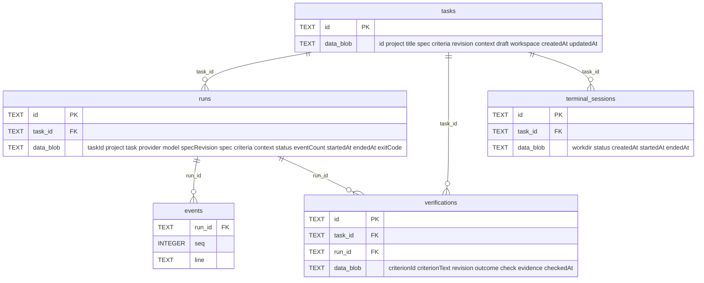

## C4 trio index

- Level 1 context: docs/architecture/c4-context.md
- Level 2 containers: docs/architecture/c4-containers.md
- Level 3 subsystems: docs/architecture/c4-components.md

## Provider strategy — args/spawn

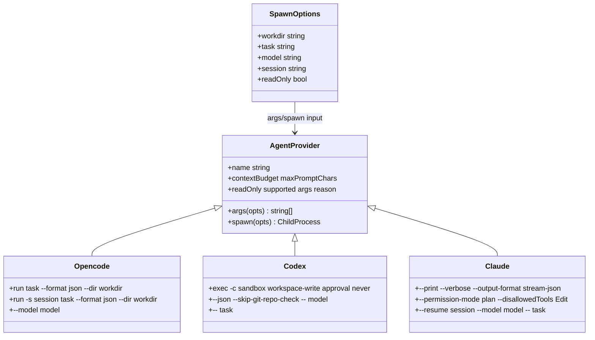

## Event pipeline — double store

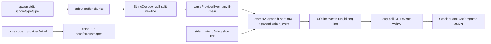

## Windows/Linux split — M7 blockers

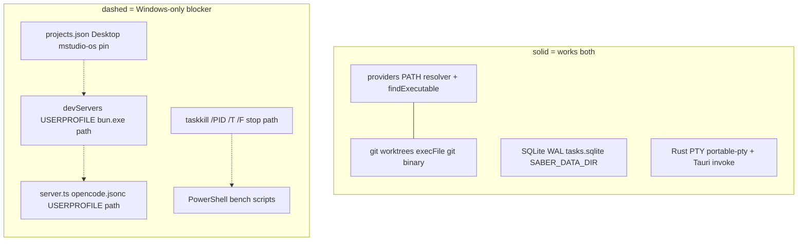

## Worktree layout — two conventions

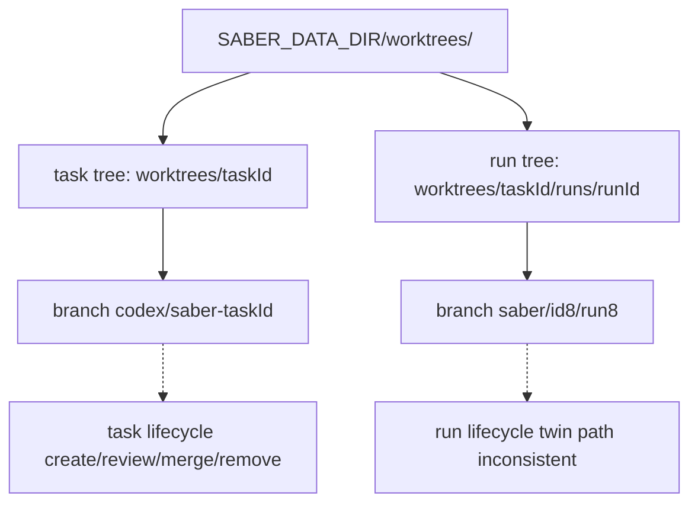

## State ownership — three owners

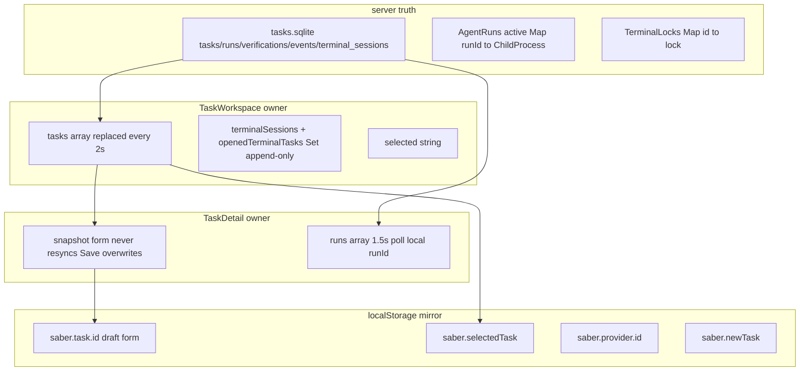

## Before/after cleanup — god router

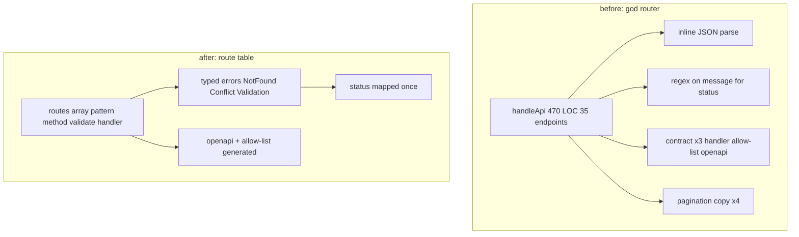

## Subsystem zoom set

- Rust shell: docs/architecture/zoom-rust.md
- Bun server: docs/architecture/zoom-server.md
- Frontend: docs/architecture/zoom-frontend.md
- Providers: docs/architecture/zoom-providers.md
- Generated route table: scripts/generate-route-table.ts emits docs/architecture/route-table.gen.md from src/server/routes/*.ts; `src/server/routes/routeScan.test.ts` fails if the scanned route set drifts

