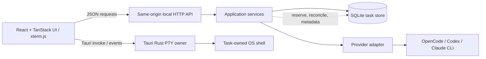
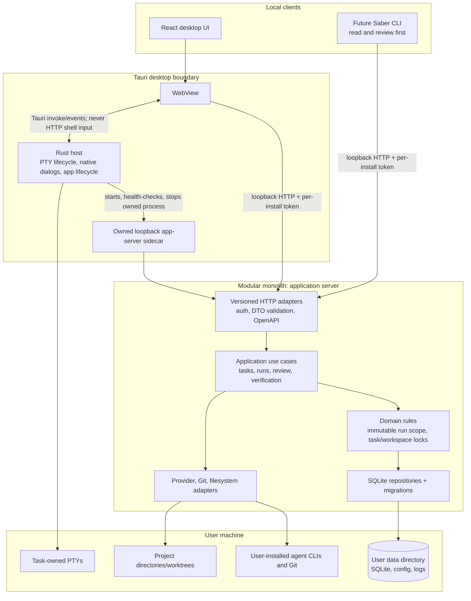

# Saber API and platform architecture

**Status:** Target architecture approved by the user on 2026-09-23. The authenticated read/review `/api/v1` API and Windows x64 packaged runtime are built and verified through MSI payload extraction, launch, UI, health, auth, loopback, and owned-process shutdown checks. A clean-account install and packaged Tauri terminal smoke remain pending. The Saber CLI is not implemented. The current application is a single-user local desktop/development system, not a supported public or LAN API.

## Recommendation

Keep Saber as a modular monolith. Define and test stable module and HTTP contracts inside the existing TanStack Start server before creating separately deployed microservices. Saber is a local desktop workspace with one local database, a native PTY owner, and local provider processes; breaking those responsibilities into network services would add deployment and synchronization work without a current scaling need.

The API should begin as a **local, authenticated control API** for Saber’s own UI and a future Saber CLI. Keep agent providers and storage behind internal interfaces. Keep interactive terminal process control in the Tauri runtime. Add remote access only after a real multi-user or remote-workspace requirement exists.

## Current runtime and stack

| Layer | Current implementation | Responsibility |
| --- | --- | --- |
| Desktop shell | Tauri v2, Rust, `portable-pty` | Owns native shell processes and forwards PTY input, resize, output, and exit events to the webview. |
| Frontend | React 19, TanStack Start/Router, Vite, Tailwind CSS v4, xterm.js | Task workspace, board, switcher, reviews, verification, and terminal display. |
| Local HTTP server | TanStack Start server entry wrapped by `src/server.ts`; Nitro builds a Node server in `.output` | Development serves through Vite on strict `127.0.0.1:8082`; packaged Saber starts its owned Node v24.21.0 server on an ephemeral IPv4 loopback port and opens the WebView only after `/api/v1/health` succeeds. |
| Package/runtime tools | Bun for package scripts and dependencies; checksum-verified Node v24.21.0 Windows x64 external binary | `bun run dev`, `bun run test`, `bun run build`, `bun run tauri:build`, terminal and responsiveness verification. Tauri owns the Bun dev child in development and the Node child in packaged mode. Windows MSI and NSIS payloads were built and exercised from extracted files. |
| Persistence | SQLite via `node:sqlite`, default `%USERPROFILE%\\.saber\\tasks.sqlite`; override with `SABER_DATA_DIR` | Persists tasks, agent runs, provider events, verification records, and terminal-session metadata. |
| Agent providers | OpenCode, Codex, and Claude Code adapters behind `AgentProvider` | Starts local provider executables with argument arrays and records normalized events. Provider installation and sign-in remain user-managed. |
| Workspaces | Git worktree service and workspace identity/overlap checks | Isolates task changes and prevents overlapping terminal/run writers. |



Task records, agent runs, and terminal sessions are separate concepts. Runs capture a specification revision and context snapshot. Terminal metadata is persisted by the server, while the live PTY is owned by Tauri. A shell is not a run and does not set task completion or verification. Keep this separation in any API or future service boundary.

## Current API surface

The routes below are implemented in `src/server.ts` and consumed by `src/lib/api.ts`. They currently return JSON with camelCase TypeScript record shapes. Error responses are generally `{ "error": "message" }`; exact validation and status behavior varies by route. This inventory is useful for current integrations but is **not a stability promise**.

### Tasks, runs, and verification

| Method and path | Current request | Current response / behavior |
| --- | --- | --- |
| `GET /api/tasks` | — | `TaskSummary[]` with latest run and derived verification summary. |
| `POST /api/tasks` | `TaskInput`: `project`, `title`, `spec`, `criteria` | `TaskRecord`, `201`. Project must resolve to an existing absolute directory or known project entry. |
| `PATCH /api/tasks/{taskId}` | Partial `title`, `spec`, `criteria`, `context`, or `draft` | Updated `TaskRecord`. Only `spec`/`criteria` changes increment the spec `revision`. |
| `GET /api/tasks/{taskId}/runs` | — | `RunRecord[]`, newest first. |
| `POST /api/tasks/{taskId}/runs` | Optional `provider`, `model`, `followup` | `{ id }`, `201`. Checks provider readiness and workspace/terminal conflicts; the run snapshots task specification, criteria, and context. |
| `GET /api/tasks/{taskId}/verifications` | — | `{ records, summary }`. Summary is derived from stable criterion IDs and current spec revision. |
| `POST /api/tasks/{taskId}/verifications` | `criterionId`, `outcome`, `check`, `evidence`, optional `runId` | `{ record, records, summary }`, `201`; stale/mismatched evidence may return `409`. |
| `GET /api/providers` | — | Readiness for OpenCode, Codex, and Claude Code. It does not install or sign in to a provider. |

### Workspaces and terminal-session metadata

| Method and path | Current request | Current response / behavior |
| --- | --- | --- |
| `GET /api/tasks/{taskId}/workspace` | — | Review projection including current head, branch, status, and diff. |
| `POST /api/tasks/{taskId}/workspace` | — | Creates the task’s isolated workspace record. |
| `DELETE /api/tasks/{taskId}/workspace` | — | Removes a clean managed worktree under the service’s safety checks. |
| `POST /api/tasks/{taskId}/workspace/merge` | `{ head }` | Merges the specifically reviewed commit if the checkout is still eligible. |
| `GET /api/tasks/{taskId}/terminals` | — | Terminal metadata for one task. |
| `POST /api/tasks/{taskId}/terminals` | — | Reserves a task-owned terminal session and workspace lock; does not spawn the shell. Returns the lock/session metadata, `201`. |
| `GET /api/terminals` | — | All persisted terminal metadata after hydrating locks. |
| `POST /api/terminals/reconcile` | `{ liveSessionIds: string[] }` | Reconciles persisted terminal status against Tauri’s live process IDs. |
| `POST /api/terminals/{sessionId}/running` | — | Marks the recorded session running. |
| `POST /api/terminals/{sessionId}/recover` | `{ confirmedStopped: true }` | Marks an interrupted session stopped only after explicit confirmation. |
| `DELETE /api/terminals/{sessionId}` | — | Stops metadata/releases its lock; refuses an interrupted session until recovery is confirmed. |

Actual shell control is **not HTTP**. Tauri exposes `terminal_start(session_id, cwd, cols, rows)`, `terminal_write(session_id, data)`, `terminal_resize(session_id, cols, rows)`, `terminal_close(session_id)`, and `terminal_list()`. Tauri emits `terminal-output:{sessionId}` and `terminal-exited:{sessionId}` events. Keep raw PTY write/spawn controls out of any generally available HTTP API.

### Runs and supporting local tools

| Method and path | Current request | Current response / behavior |
| --- | --- | --- |
| `GET /api/sessions` | — | Legacy name for the list of agent `RunRecord`s. |
| `POST /api/sessions` | `{ project, task, model? }` | Legacy combined operation: creates a task and starts an OpenCode run; returns `{ id }`, `201`. Prefer task/run resources for new integrations. |
| `GET /api/sessions/{runId}/events?after={seq}&wait=1` | Cursor; optional long poll (up to 25 seconds) | `{ status, next, lines, hasMore }`; each line contains a serialized Saber/provider event. |
| `POST /api/sessions/{runId}/stop` | — | Stops an owned provider process; `{ ok: true }` or conflict/error. |
| `POST /api/sessions/{runId}/followup` | `{ task }` | Starts a follow-up on the same provider’s captured native session; returns `{ id }`, `201`. |
| `POST /api/sessions/{runId}/acknowledge` | `{ processStopped: true }` | Confirms an interrupted **agent run** process has stopped; separate from terminal recovery. |
| `GET /api/projects` | — | Reads the configured project inventory. |
| `GET /api/default-model` | — | Best-effort OpenCode default-model config read. |
| `GET /api/dev-servers`; `POST /api/dev-servers/start`; `POST /api/dev-servers/stop` | Start/stop accepts `{ project }` | Shared local development-server registry and control. |
| `POST /api/browser/goto`; `POST /api/browser/act`; `GET /api/browser/screenshot` | Local browser actions | Shared embedded-browser control and screenshot. These are powerful local controls, not suitable for exposure as-is. |

## Shared contract types

The current canonical shapes are in `src/lib/tasks.ts`:

- `TaskInput`: `project`, `title`, `spec`, `criteria`.
- `TaskPatch`: optional `title`, `spec`, `criteria`, `context`, `draft`.
- `TaskRecord`: `id`, `project`, `title`, `spec`, `criteria`, `revision`, `context`, `draft`, millisecond `createdAt`/`updatedAt`, optional `workspace`.
- `TaskSummary`: `TaskRecord` plus optional `latestRun` and derived `verificationSummary`.
- `RunRecord`: `id`, `taskId`, resolved project/workdir, submitted task/prompt, provider/model, native session ID, `specRevision`, snapshot `spec`/`criteria`/`context`, status, event count, timestamps, and exit code.
- `TerminalSessionRecord`: `id`, `taskId`, `workdir`, `status`, and lifecycle timestamps. It describes the PTY; it is not the PTY process itself.
- `VerificationRecord`: criterion ID/text, spec revision, outcome, check, evidence, optional run ID, and check time.

Task/run/terminal/verification status must remain derived or lifecycle-controlled. Callers do not get a generic `status` setter. A successful agent run is review-ready; only current passing evidence for every acceptance criterion makes a task verified.

## Recommended public-to-local API v1 contract

Use OpenAPI 3.1 as the machine-readable source of truth and derive or validate TypeScript request/response types from it. Treat the current `/api/*` endpoints as internal compatibility surfaces while the contract is implemented and migrated. New external clients should use `/api/v1/*` only after the following foundation exists:

1. **Local-only transport:** bind the server explicitly to loopback, validate the Host/Origin, deny cross-origin browser access by default, and require a per-install bearer token for CLI or local app integrations. Redact that token and all project/provider secrets from logs. Do not expose it to the LAN or internet.
2. **Stable DTOs:** define API request/response schemas separately from SQLite row JSON and UI state. Use opaque IDs, ISO 8601 UTC timestamps, explicit enum values, bounded strings/arrays, and documented optionality. Do not expose `nativeSessionId`, raw provider output, local executable paths, or database layout unless a scoped endpoint needs them.
3. **Consistent semantics:** use `{ data: ... }` for success resources, `{ error: { code, message, details?, requestId } }` for errors, stable HTTP status codes, cursor pagination for collections, and `Idempotency-Key` for task/run creation. Use `ETag`/`If-Match` or a separate aggregate version for concurrent task edits; do not reuse `revision`, which currently tracks spec/criteria changes only.
4. **Run stream contract:** first stabilize the existing monotonic event sequence and cursor behavior, then expose it as SSE or a documented long-poll resource. Do not conflate provider-run events with terminal output events.
5. **Capability boundaries:** task CRUD and run metadata are appropriate for the first API slice. Provider run start/stop and worktree create/remove/merge are side effects and need explicit scopes, conflict responses, and audit events. Terminal spawn/input remains Tauri-owned and is not part of general API v1. Browser automation and shared dev-server controls stay internal until separately secured and justified.

Implemented initial read/review resources:

| Proposed route | Purpose |
| --- | --- |
| `GET /api/v1/health` | Minimal readiness and API version; no authentication or machine detail. |
| `GET /api/v1/openapi.json`; `GET /api/v1/providers` | Authenticated OpenAPI contract and provider readiness projection. |
| `GET /api/v1/tasks`; `GET /api/v1/tasks/{taskId}` | Task DTOs with project basename and stable timestamps. |
| `GET /api/v1/tasks/{taskId}/runs`; `GET /api/v1/runs/{runId}` | Run metadata without native provider session identity or project path. |
| `GET /api/v1/runs/{runId}/events?after={seq}&limit={n}` | Ordered event summaries and cursor; raw provider output/text is omitted. |
| `GET /api/v1/tasks/{taskId}/verifications` | Criterion evidence tied to spec revision. |
| `GET /api/v1/tasks/{taskId}/workspace` | Head, branch, and changed-file count; no diff or absolute paths. |

Every endpoint except minimal health requires the per-user bearer token. All routes are GET-only; worktree and run mutations are not part of this contract. The implementation is recorded in `docs/superpowers/specs/2026-09-23-local-api-foundation.md`.

Suggested error codes include `unauthorized`, `validation_error`, `cursor_invalid`, `not_found`, `conflict`, `provider_unavailable`, `workspace_busy`, `stale_revision`, `operation_not_allowed`, and `internal_error`. Map validation to `400`/`422`, missing resources to `404`, lifecycle/workspace conflicts to `409`, and unexpected failures to `500` with a request ID; never return stack traces or raw process launch details.

## Module structure to grow toward

Keep module boundaries in the same process and make them explicit:

```text
src/
  api/                 HTTP route adapters, DTO validation, OpenAPI document
  application/         task/run/workspace/verification use cases
  domain/              task, run, verification, and workspace invariants
  infrastructure/
    persistence/       SQLite repositories and migrations
    providers/         OpenCode, Codex, Claude adapters and event normalization
    workspaces/        Git worktree implementation
    devtools/          local dev-server and browser tools (internal capability)
  desktop/             typed Tauri command/event bridge
  components/          React projections and interaction components
  lib/                 shared UI/domain types only where safe to share
```

This is a target organization, not a request to move every file immediately. Move a seam when a feature touches it: HTTP handlers should parse/validate and call application use cases; use cases should own product rules; repositories and provider/OS integrations should sit behind interfaces; UI components should display results rather than enforce workspace safety. Keep current TypeScript types until stable DTO mapping exists.

## Full target application architecture

Saber is one local desktop product with three cooperating execution areas: a web UI, a loopback application server, and a Tauri/Rust native host. The CLI is a future client of the same versioned HTTP contract, not a second backend. OpenCode, Codex, Claude Code, shells, Git, and user project processes remain user-installed local tools. Saber discovers and invokes configured providers; it does not provision them.



### Runtime and ownership

| Runtime component | Owns | Must not own |
| --- | --- | --- |
| Tauri WebView | UI state, navigation, rendered terminal surfaces, client-side drafts | Provider processes, SQLite access, authoritative task/run rules |
| Rust host | Starting/stopping Saber’s packaged server, readiness handshake, app shutdown, native PTYs and their output events | Task/run persistence or provider protocol interpretation |
| Application server sidecar | Authenticated local HTTP API, use cases, provider process lifecycle, Git/workspace operations, DB transactions and migrations | Arbitrary shell stdin or PTY spawn API exposed over HTTP |
| SQLite store | Durable tasks, run snapshots/events, verification evidence, workspace metadata, settings needed to restore product state | Live processes or shell history |
| Providers and Git | Their own subprocess behavior and native session formats | Saber task state; Saber records provider IDs and normalized events |
| Future CLI | Client-side presentation and API calls using the local token | Direct DB access or alternate business rules |

Development can continue to use Bun scripts and port 8082. A packaged desktop build must start only the server process it owns, bind to an available loopback port, wait for a health/readiness response before opening the WebView, and stop that owned process when the app exits. It must never silently attach to an unrelated process already listening on 8082. Production bundling choice (Bun compiled sidecar versus a supported Node runtime/sidecar) is an explicit release spike; do not claim release readiness until a clean-machine Windows bundle has been installed, launched, authenticated locally, and shut down successfully. Keep Linux/macOS as later platform verification.

### Data and module boundaries

The user data root defaults to `%USERPROFILE%\\.saber` on Windows and the platform-appropriate per-user application data directory elsewhere; `SABER_DATA_DIR` remains a development/test override. SQLite is the authority for durable app state and schema changes use ordered, transactional migrations. Logs rotate or are bounded and redact bearer tokens, credentials, environment values, and sensitive provider output. Project files and worktrees remain at their selected paths and are never copied into app data.

Use cases are the stable internal boundary: task CRUD and spec revisions; immutable run creation and lifecycle; normalized run-event cursors; criterion verification; workspace review and explicit future mutations; provider readiness and invocation. Repositories and adapters implement those operations. HTTP routes and the UI call the same use cases. DTOs are versioned and mapped at the API edge so SQLite rows and UI view models can evolve independently. Prefer the existing tree and extract modules only when a slice needs a seam; do not perform a repository-wide rewrite.

### Initial API capability and trust model

The first supported external surface is a **read/review CLI API**. It can report health/version, provider readiness, task summaries/details, runs and resumable run events, verification records, and workspace review data. It cannot create or edit tasks, start/stop/follow up provider runs, write verification, create/remove/merge worktrees, control dev servers or browser automation, or spawn/write/resize/close terminals. The app’s own UI may continue using its internal routes during migration; those internal routes are not implicitly part of the CLI contract.

The sidecar binds to loopback only. A random per-install token is created with restrictive file permissions/ACLs and is never returned by health or API responses. The desktop UI receives it through a private bootstrap channel and the CLI reads it from Saber’s private config location; never put it in a URL, command-line argument, browser storage, or logs. Require bearer auth on `/api/v1/*` except minimal health readiness if necessary; if health is unauthenticated it reveals only `{status, apiVersion}`. Require exact loopback Host validation, reject unexpected origins, do not enable wildcard CORS, and bind only `127.0.0.1`/`::1`. Browser-based cross-site requests must not be able to use the CLI credential. Limit body and query sizes, use constant-time token comparison, and return generic unauthorized responses.

In the current implementation, the token file is `$SABER_DATA_DIR/api-token`, defaulting to `%USERPROFILE%\\.saber\\api-token` on Windows and `~/.saber/api-token` on Unix-like systems. The app creates it on the first protected API request. There is no CLI token bootstrap command yet; the eventual CLI will read the file under the same user account.

### Contract and errors

OpenAPI 3.1 is the source of truth for stable API DTOs and is checked in with the implementation. Use ISO-8601 UTC timestamps and bounded page sizes/cursors. Success responses use `{data: ...}` and list responses include a stable next cursor. Errors use `{error:{code,message,requestId}}`; do not return stack traces, raw paths, environment variables, process command lines, or provider secrets. Stable initial codes: `unauthorized`, `validation_error`, `not_found`, `conflict`, `cursor_invalid`, and `internal_error`. Read-only endpoints use `GET`; unsupported mutation methods return `405` with `Allow`. No compatibility guarantee attaches to existing unversioned `/api/*` routes.

### Technology decisions and deferred boundaries

- Keep the current UI stack: Bun package manager/scripts, React 19, TanStack Start/Router, Vite, Tailwind v4, and Tauri v2 with Rust and `portable-pty`.
- Keep SQLite for this single-user local product; use one owned connection strategy and transactional migrations. Do not add a separate database container.
- Keep providers and Git as in-process adapter modules that launch user tools. Do not split provider, task, terminal, or workspace microservices.
- Keep terminal bytes on the Tauri command/event bridge. They are not agent-run events and do not enter the CLI API.
- Package the application server as an owned Tauri sidecar once the runtime spike establishes a reliable Windows release path. Do not bundle provider CLIs or sign in for users.
- Add a public remote/team API, user accounts, cloud database, job queue, container orchestration, and independently deployed microservices only when a concrete multi-user/remote execution requirement justifies them.

## Delivery slices

1. **API foundation and read/review resources — verified on Windows:** OpenAPI contract, read-only DTO routes, local token, loopback/Host/Origin protections, safe errors, and tests. No CLI mutation scopes.
2. **Owned runtime — next:** Tauri-managed Node sidecar startup on a dynamic loopback port, readiness handshake, no foreign-port reuse, shutdown, installer bundle, and clean-install verification. The spec is `docs/superpowers/specs/2026-09-23-owned-server-runtime.md` and awaits user review.
3. **CLI:** a minimal CLI consumes only the read/review contract. Mutating API scopes are separate future specs with explicit authorization, audit, and concurrency semantics.
4. **Cross-platform release:** Linux/macOS packaging and verification after the Windows runtime is stable.

## Key decisions / open release spike

- Product architecture: approved modular monolith, not microservices.
- First API deployment: local-only desktop API, with a future CLI client.
- First CLI capabilities: read/review only; no workspace or run mutation.
- Authentication: private per-user token and loopback transport.
- Runtime spike completed on Windows x64 with Node v24.15.0: the production `.output/server/index.mjs` started with `HOST=127.0.0.1` and `PORT=0`, reported its selected port, and passed the health request. Prefer a bundled Node sidecar for the next slice because it matches the documented server runtime and exposes a usable readiness address. Still verify Tauri packaging and shutdown before locking the release strategy.

Tauri’s documented external-binary packaging accepts target-triple-suffixed sidecars and its shell plugin streams process output from Rust; this fits the observed Nitro startup line and health handshake. See [Tauri external sidecars](https://v2.tauri.app/develop/sidecar/) and [Tauri bundle configuration](https://v2.tauri.app/reference/config/).

## Codex in Saber

Codex is usable **now** in two ways on the current Windows development build:

1. **Interactive terminal:** open a task rooted at a project, use Saber’s native Tauri terminal, and run `codex` as an ordinary command. If needed, install the Codex CLI and sign in with `codex login` in the user’s normal environment first. This uses the CLI’s interactive experience and its configured approvals. Saber does not install or authenticate it for the user.
2. **Saber-managed agent run:** choose Codex in the task’s provider controls. The Codex adapter is implemented and the receipt at `docs/superpowers/specs/2026-09-22-provider-adapters-verification.md` records live launch and follow-up. It invokes `codex exec` with JSON output, workspace-write sandboxing, and noninteractive approval refusal; it does not provide a permission-prompt bridge. The user must stop/review a run through Saber and verify acceptance criteria explicitly.

For developing Saber itself, create/select a task for the Saber repository and use a task worktree when parallel or isolated edits are wanted. Interactive use can start immediately once the desktop terminal is open and Codex CLI is installed/authenticated. The managed provider workflow is already implemented and smoke-tested. What is **not** ready is a packaged end-user release: current Tauri config points at `http://localhost:8082`, the Rust shell starts `bun run dev`, and `bundle.active` is false. Before calling this a production desktop build, package the frontend/server sidecar, choose a collision-safe loopback port and readiness handshake, and run release-install verification.

## API and release readiness work, in order

1. **Implemented in this slice:** read-only versioned DTO routes, OpenAPI document, private local token, loopback listener, Host/Origin checks, bounded requests, and safe errors. Contract tests use handler-level fixtures; an installed CLI consumer does not exist yet.
2. Add integration tests against the running server and decide whether an untrusted local web origin needs stricter browser-client separation before shipping a CLI.
3. Add the Saber CLI as the first external API client. Keep raw terminal input out of the general API.
4. Package and verify the owned desktop runtime: prove Bun compiled sidecar versus Node runtime, dynamic loopback port, readiness/shutdown, and a clean Windows install.
5. Do not start microservices unless independent deployment, scaling, or remote collaboration creates a measured need.

## Evidence sources

- Runtime/API handler: `src/server.ts`
- Frontend API client: `src/lib/api.ts`
- Shared record types: `src/lib/tasks.ts`
- SQLite and lifecycle invariants: `src/server/taskStore.ts`, `src/server/agentRuns.ts`, `src/server/terminalLocks.ts`
- Provider interface and Codex adapter: `src/server/providers/types.ts`, `src/server/providers/codex.ts`
- Native PTY boundary: `src-tauri/src/main.rs`, `src-tauri/src/terminal.rs`, `src-tauri/capabilities/default.json`
- Runtime configuration: `vite.config.ts`, `src-tauri/tauri.conf.json`, `package.json`
- Live Codex receipt: `docs/superpowers/specs/2026-09-22-provider-adapters-verification.md`
